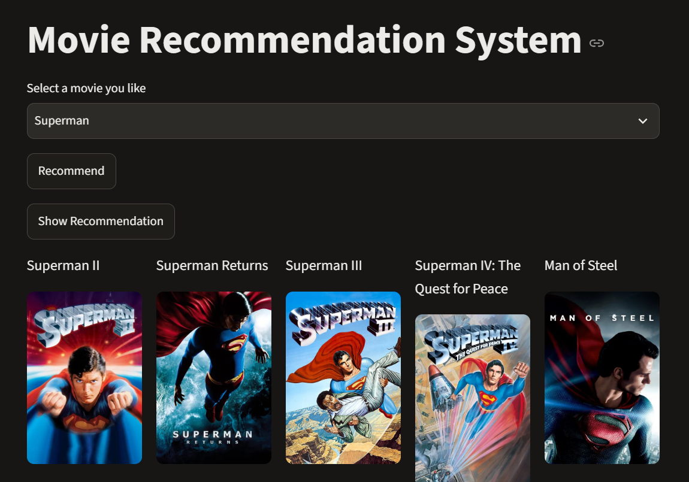

# 🎬 Movie Recommendation System
 
A content-based movie recommender built with Python and Streamlit. Select a movie and get five similar recommendations with posters.
 
**🚀 [Live Demo](https://movie-recommender-app01.streamlit.app/)**
 
[](https://movie-recommender-app01.streamlit.app/)
 
## Tech Stack
Python, Pandas, Scikit-learn, Streamlit, TMDB API
 
## Run Locally
```bash
git clone https://github.com/YOUR-USERNAME/movie-recommendation-system.git
cd movie-recommendation-system
pip install -r requirements.txt
streamlit run app.py
```
 
## Dataset
[TMDB 5000 Movie Dataset](https://www.kaggle.com/datasets/tmdb/tmdb-movie-metadata)
 
## License
MIT
 
